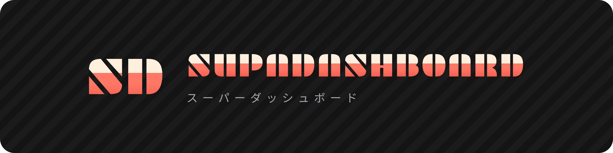
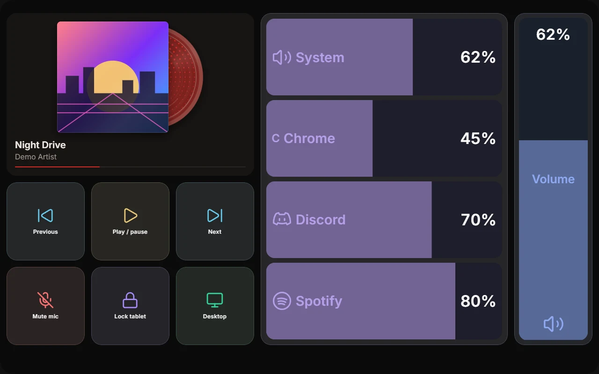
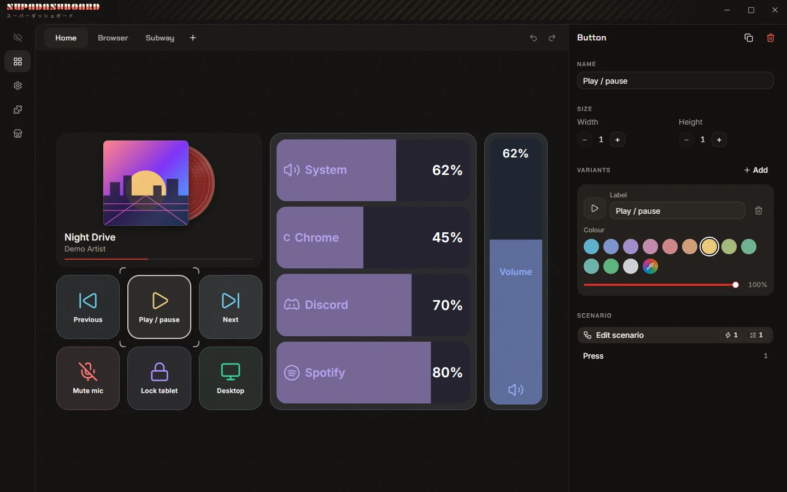
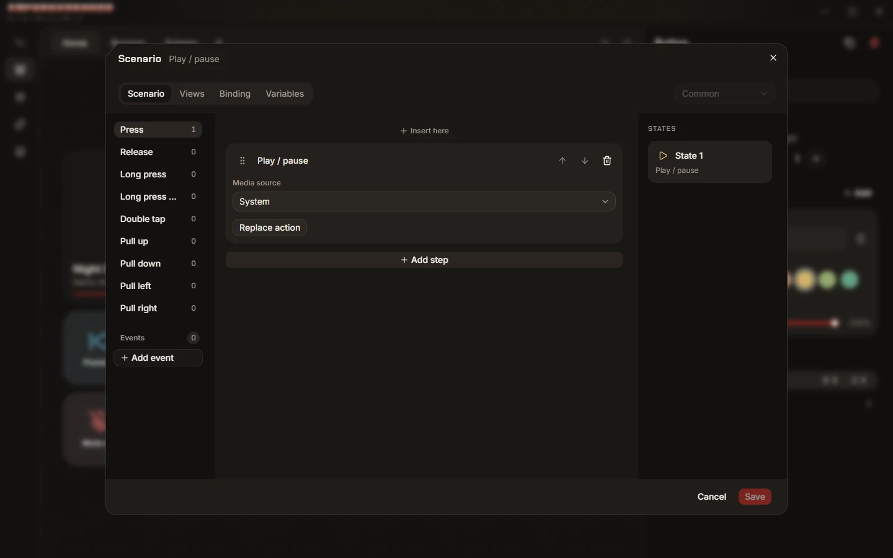
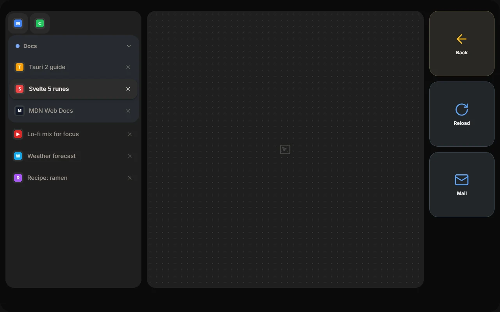
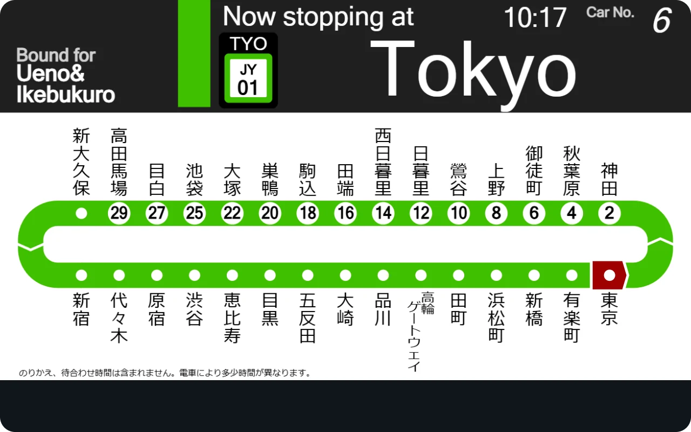
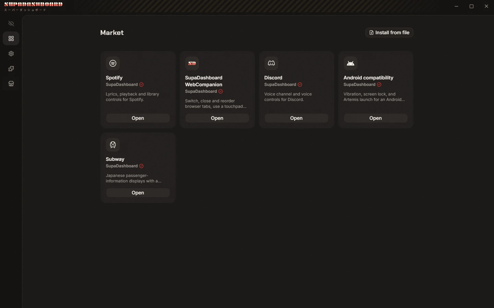

<p align="center">
  
</p>

<p align="center">
  A touch dashboard for a second screen, running natively on your Windows PC.
</p>

<p align="center">
  <a href="LICENSE"></a>
  
</p>

<p align="center">
  
</p>

## What it does

SupaDashboard turns a tablet or any spare monitor into a control surface for your PC. You build pages of
widgets in a control panel: buttons, sliders, a per-app volume mixer, now playing, images, video and web pages.
Each widget runs scenarios on taps, holds and swipes, and changes how it looks from variables and events.
Plugins from the built-in Market add more, such as Spotify lyrics, Discord voice controls and browser control.

## Why SupaDashboard

I tried the existing stream-deck apps and tablet companions first. Their logic stopped at one action per button,
their interfaces felt dated, and I could not change how they worked. Most of them run a client on the tablet that
talks to a server on the PC over the local network, so the dashboard only knows what that protocol exposes. I
wanted a closer connection to the PC, so I built my own: SupaDashboard runs on the PC itself, and the tablet is
just another screen.

## How it connects

- **The dashboard is a native window on the PC.** SupaDashboard is a Windows app built with Tauri 2 (Rust) and
  Svelte 5. The dashboard is a frameless, transparent window that never takes focus from the app you are using. Put
  it on any monitor, windowed or fullscreen, optionally always on top.
- **The tablet is a Windows display.** Extend the desktop to the tablet with
  [spacedesk](https://www.spacedesk.net/) (USB cable or Wi-Fi) or with [Apollo](https://github.com/ClassicOldSong/Apollo)
  and [Artemis](https://github.com/ClassicOldSong/moonlight-android) (virtual display), then move the dashboard onto
  it. Touch arrives as ordinary Windows input. Nothing else runs on the tablet.
- **Widgets talk to Windows directly**: media sessions, per-app volume and app windows, with no protocol in between.
- **Optional ADB link.** The Android compatibility plugin uses ADB over USB to vibrate the tablet on presses, lock it
  with the PC and start the Artemis stream when the PC wakes.

## Features

<table>
  <tr>
    <td width="50%"></td>
    <td width="50%"></td>
  </tr>
  <tr>
    <td><b>Layout editor.</b> Drag, resize and style widgets on a grid, with pages, undo and redo. Every change
      shows on the dashboard at once.</td>
    <td><b>Scenarios.</b> Steps for press, release, long press, double tap and swipes, with delays, conditions,
      variables, expressions and events. Buttons switch states from bindings.</td>
  </tr>
  <tr>
    <td width="50%"></td>
    <td width="50%"></td>
  </tr>
  <tr>
    <td><b>Browser control.</b> WebCompanion lists, switches, closes and reorders tabs and turns a widget into a
      touchpad for the browser.</td>
    <td><b>Applets.</b> A plugin can take over a whole page. Subway recreates Japanese train information
      displays.</td>
  </tr>
</table>

- **Widgets**: buttons with states, sliders, volume mixer, now playing, images and video, web pages.
- **Actions**: media playback, system and per-app volume, pages, open, focus, minimize, close or quit apps and move their
  windows between displays, open links, variables and events.
- **Tile effects** such as ripple, confetti and glow on presses.
- **Control panel** in the tray: Layout, Settings, Plugins and Market.

## Plugins

<p align="center">
  
</p>

Plugins live in the [plugin library](https://github.com/McFck/supadashboard-plugins) and install from the Market
in the control panel. CI builds and signs every release, and the app checks the signature against a pinned key
before it loads a plugin. Before installing, the app lists what a plugin may access: websites, sign-ins, programs
or your browser.

| Plugin                     | What it adds                                                       |
| -------------------------- | ------------------------------------------------------------------ |
| Spotify                    | Synced lyrics, Spotify as a media source, like, shuffle and repeat |
| SupaDashboard WebCompanion | Browser tabs, touchpad, websites and media in a Chromium browser   |
| Discord                    | Voice channel widget and mute, deafen, leave and rejoin            |
| Android compatibility      | Vibration, screen lock and Artemis launch over ADB                 |
| Subway                     | Japanese train information displays as an applet                   |

## Build from source

There is no prebuilt installer yet. You need Windows 10 or 11 with WebView2,
[Rust](https://rustup.rs/) with the MSVC build tools, Node.js 24 and pnpm 9.

```powershell
git clone https://github.com/McFck/SupaDashboard.git
cd SupaDashboard/app
pnpm install
pnpm tauri dev      # run the app
pnpm tauri build    # installer in target/release/bundle
```

The control panel opens from the tray icon. See [app/README.md](app/README.md) for the source layout and plugin
development modes.

## License

[GNU General Public License v3.0 or later](LICENSE): anyone may use, study, change and share it, provided that what
they distribute stays free under the same terms.
